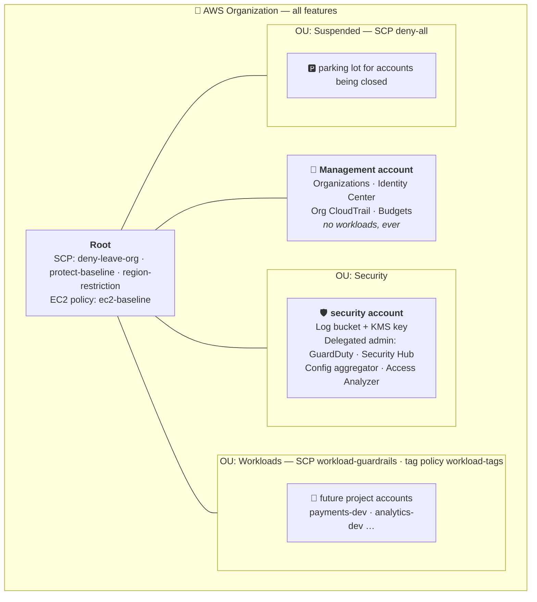
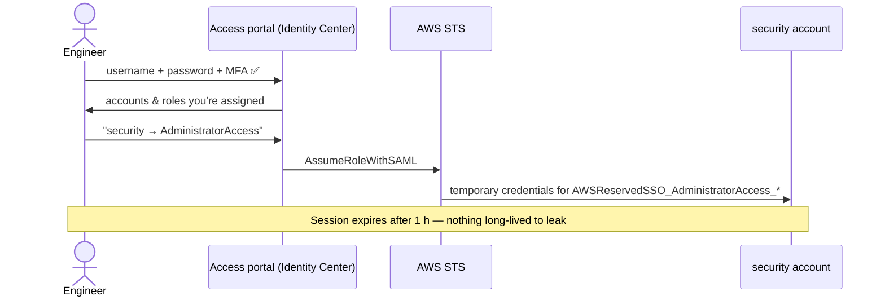
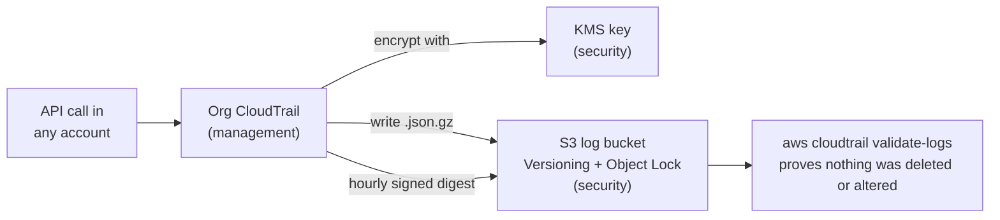
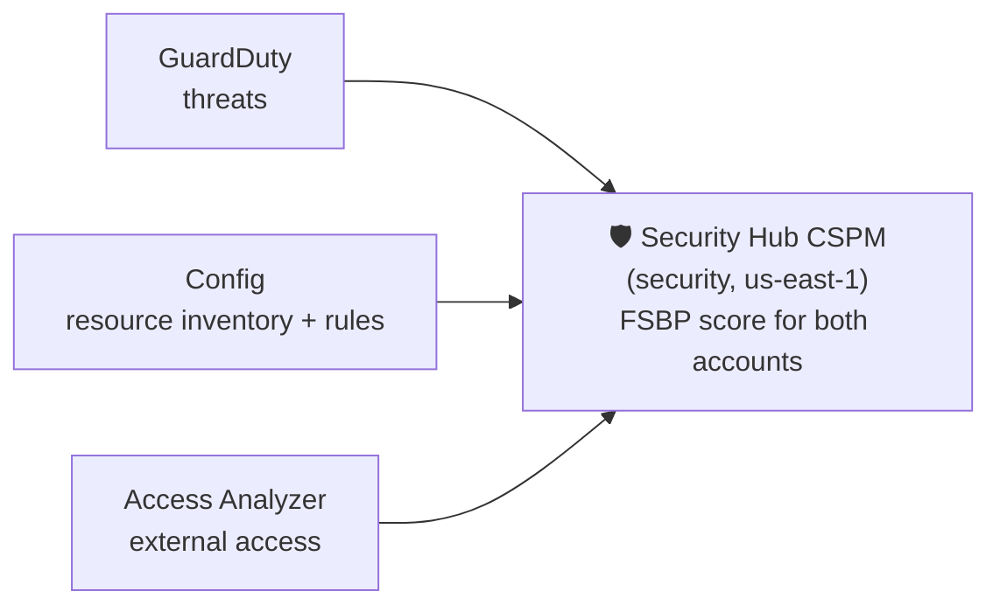

# Lab 1 — Build an Enterprise Landing Zone by Hand

> **Two AWS accounts. Fifteen compliance controls. One security console.**
> Build the foundation every serious AWS customer starts with: AWS Organizations, single sign-on, guardrails no admin can switch off, and audit logs nobody can quietly delete. You build it click by click first, then as Terraform.

| | |
|---|---|
| **Level** | Intermediate. You know IAM basics and the AWS console. |
| **Accounts** | 2: management + security. Fits a free account's default quota. |
| **Time** | About 6–8 hours across 8 phases |
| **Cost** | About $1/month (KMS key). GuardDuty and Security Hub are free for 30 days, then a few USD/month. |
| **Region** | `us-east-1` (home). `ap-south-1` is allowed but unused. |
| **Tools** | AWS console, AWS CLI v2, Terraform ≥ 1.10 |

---

## 📖 The story

**AcmeCorp** runs everything in *one* AWS account. Thirty engineers share IAM users. Nobody knows who deleted the staging database last month. The finance team can't tell which project spends what. An auditor is coming in Q3.

The new platform team gets four goals:

1. 🏢 **Separate accounts.** Each project gets its own blast radius and its own bill.
2. 🔑 **One login.** SSO with MFA for everyone, and no more IAM users.
3. 🚧 **Guardrails that admins can't turn off.** Not even admins inside the member accounts.
4. 🔍 **One place to see everything.** Every API call is logged and every threat is visible, in a dedicated security account.

You are the platform team. This lab builds the **foundation**: the management and security accounts, plus a ready-made *Workloads* area. Project accounts (Payments, Analytics) can be added later without changing anything here.

> [!NOTE]
> AWS Control Tower automates most of this. We build it **by hand on purpose**: once you've wired every piece yourself, Control Tower stops being magic, and you can debug it when it breaks.

---

## 🎯 What you'll be able to explain afterwards

- Why the **management account** should hold almost nothing, and why SCPs never apply to it
- How **Identity Center** turns one login into short-lived roles in every account
- Why a versioned bucket is **not** immutable, and what makes it so
- How **SCPs** are evaluated, why they never grant anything, and how to test them safely
- What a **delegated administrator** is, and why it can't disable itself
- How **GuardDuty**, **Security Hub**, **Config** and **Access Analyzer** fit together

---

## 🏗️ Architecture



### How the pieces talk to each other

**1 — Signing in (no IAM users anywhere)**


**2 — Every API call becomes evidence**


**3 — Every finding lands in one place**


---

## ✅ Compliance controls

Each control is enforced by a real mechanism, verified by a test, and linked to the phase that builds it.

| # | Requirement | Enforced by | Type | Phase |
|---|---|---|---|---|
| C1 | MFA for every human | Identity Center: MFA at every sign-in | 🛑 Preventive | [2](docs/02-identity-center.md) |
| C2 | No IAM users or access keys in workload accounts | SCP `workload-guardrails` | 🛑 Preventive | [5](docs/05-guardrails.md) |
| C3 | No root user in member accounts | Centralized root access + SCP `protect-baseline` | 🛑 Preventive | [3](docs/03-root-lockdown.md), [5](docs/05-guardrails.md) |
| C4 | No public S3 | Account-level Block Public Access, locked by SCP | 🛑 Preventive | [5](docs/05-guardrails.md) |
| C5 | Approved regions only (`us-east-1`, `ap-south-1`) | SCP `region-restriction` | 🛑 Preventive | [5](docs/05-guardrails.md) |
| C6 | Accounts can't leave the org or close themselves | SCP `deny-leave-org` | 🛑 Preventive | [5](docs/05-guardrails.md) |
| C7 | Security services can't be disabled | SCP `protect-baseline` | 🛑 Preventive | [5](docs/05-guardrails.md) |
| C8 | Encryption at rest | EBS default encryption + SCP | 🛑 Preventive | [5](docs/05-guardrails.md) |
| C9 | IMDSv2; no public AMIs or snapshots | EC2 declarative policy + SCP | 🛑 Preventive | [5](docs/05-guardrails.md) |
| C10 | Mandatory tags `Project` / `Environment` / `Owner` | Tag policy + SCP | 🛑 Preventive | [5](docs/05-guardrails.md) |
| C11 | Tamper-evident audit trail | Org CloudTrail → KMS + Object Lock + log file validation | 🔍 Detective | [4](docs/04-logging.md) |
| C12 | Continuous configuration compliance | Config in every account + org aggregator | 🔍 Detective | [6](docs/06-security-services.md) |
| C13 | Threat detection and posture | GuardDuty + Security Hub (FSBP), org-wide | 🔍 Detective | [6](docs/06-security-services.md) |
| C14 | Cost control | AWS Budgets with alerts | 🔍 Detective | [0](docs/00-prep.md) |
| C15 | Audit logs immutable, **even for admins** | SCP denies Object Lock bypass on the log bucket | 🛑 Preventive | [5](docs/05-guardrails.md) |

> [!TIP]
> C15 wasn't in the original design. It was added after Phase 4, when an admin managed to delete a "locked" log file. The [Phase 4 field notes](docs/04-logging.md#-field-notes) explain how.

---

## 🗺️ The journey

| Phase | You build | Key lesson | Status |
|---|---|---|---|
| [0 · Prep](docs/00-prep.md) | Secure management account, budget, CLI | Lock the front door before you build the house | ✅ |
| [1 · Organization](docs/01-organization.md) | Org, 3 OUs, security account | OUs are where policy lives; accounts are where work lives | ✅ |
| [2 · Identity Center](docs/02-identity-center.md) | SSO, MFA, groups, permission sets | Permission sets become roles in every account | ✅ |
| [3 · Root lockdown](docs/03-root-lockdown.md) | Centralized root access management | The safest root password is one that doesn't exist | ✅ |
| [4 · Logging](docs/04-logging.md) | Org trail → encrypted, locked bucket | "Versioned" ≠ "immutable" | ✅ |
| [5 · Guardrails](docs/05-guardrails.md) | 5 SCPs, tag policy, EC2 policy | Test with the right principal, and test safely | ✅ |
| [6 · Security services](docs/06-security-services.md) | GuardDuty, Security Hub, Config, Access Analyzer | Delegated admins can't fire themselves | ✅ |
| [7 · Validate](docs/07-validation.md) | Run every control test | A control you haven't tested is a hope | ⏳ |
| [8 · Cleanup](docs/08-cleanup.md) | Tear it down in the right order | Your guardrails will fight your cleanup | ⏳ |

---

## 🧰 Prerequisites

- [ ] An AWS account on the **Paid plan**. On the Free plan, Organizations may be unavailable. Credits still apply after you upgrade.
- [ ] Root user **MFA**, no root access keys
- [ ] AWS CLI v2 and Terraform ≥ 1.10
- [ ] Organizations account quota **≥ 2**. That's the default, so no increase is needed.
- [ ] A Gmail-style address that supports `+aliases`, for the second account's email (e.g. `you+acme-security@gmail.com`)

---

## 💰 Cost

| Item | Cost |
|---|---|
| Organizations, Identity Center, SCPs, tag and EC2 policies, Access Analyzer (external access) | Free |
| CloudTrail org trail (management events, first copy) | Free |
| KMS key | ~$1/month |
| S3 log and Config buckets | Cents (30-day lifecycle) |
| Config recording (2 accounts, 1 region) | Cents |
| GuardDuty | 30-day trial, then ~$1–4/month |
| Security Hub CSPM (FSBP only) | 30-day trial, then ~$1–3/month |

> [!WARNING]
> Set a reminder for **day 25** of the GuardDuty and Security Hub trials. Decide then whether to keep them or run [Phase 8](docs/08-cleanup.md).

---

## 🔥 Top lessons from building this

These all happened while building this lab. Each phase's **Field notes** section has the full story.

1. **A versioned bucket isn't immutable.** A normal delete only adds a *delete marker*. The S3 console then *silently bypassed* Object Lock Governance mode for an admin. → [Phase 4](docs/04-logging.md#-field-notes)
2. **CloudTrail didn't log the deletion.** S3 object deletes are *data events*. Only `validate-logs` caught it. → [Phase 4](docs/04-logging.md#-field-notes)
3. **Test SCPs with the right principal.** The management account and the exempt break-glass role are immune, so testing as them proves nothing. → [Phase 5](docs/05-guardrails.md#-field-notes)
4. **AWS defaults can satisfy your deny conditions.** An AMI with `ImdsSupport: v2.0` and EBS default encryption made "bad" requests compliant. → [Phase 5](docs/05-guardrails.md#-field-notes)
5. **Check the region selector before every click.** GuardDuty and Security Hub ended up in Ireland and 16 other regions. → [Phase 6](docs/06-security-services.md#-field-notes)
6. **A delegated admin can't disable itself.** You remove the delegation first. → [Phase 6](docs/06-security-services.md#-field-notes)
7. **Your guardrails will block your own cleanup.** That's what break-glass roles are for. → [Phase 6](docs/06-security-services.md#-field-notes)

---

## 🏗️ Terraform

Everything above, as code. Seven stacks, each with its own state file. See **[terraform/README.md](terraform/README.md)**.

```
terraform/
├── bootstrap/         remote state bucket
├── organization/      org, OUs, security account, root access mgmt, budget
├── identity-center/   groups, users, permission sets, assignments
├── logging/           org trail (management) + log bucket & KMS key (security)
├── security/          GuardDuty, Security Hub, Config, Access Analyzer (delegated to security)
├── guardrails/        SCPs, tag policy, EC2 policy — read from ../policies
└── modules/
    └── config-recorder/   Config recorder + bucket, used once per account
```

## 📁 Folder layout

```
1/
├── README.md        ← you are here
├── docs/            one guide per phase: why, steps, verify, field notes, interview corner
├── policies/        every SCP / tag / EC2 / KMS / bucket policy as JSON
└── terraform/       the same landing zone as code
```
