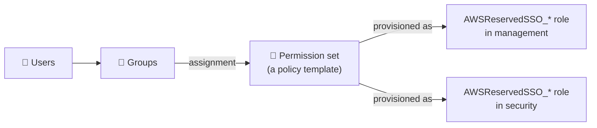

# Phase 2 — Identity Center: One Login to Rule Them All

> **Mission:** everyone signs in once, with MFA, and gets short-lived roles in exactly the accounts they need. No IAM users. (Control **C1**)

[⬅ Phase 1](01-organization.md) · [Lab overview](../README.md) · [Phase 3 ➡](03-root-lockdown.md)

---

## Why this matters

IAM users have **long-lived** passwords and access keys, and those leak. IAM Identity Center (the successor to AWS SSO) gives people a **single portal**. Behind the scenes it creates a role in each account and hands out **temporary** credentials (1–12 hours). Remove someone from a group and their access disappears from every account at once.

## How it fits together



A **permission set** is a template. When you assign *group + permission set + account*, Identity Center creates a role called `AWSReservedSSO_<PermissionSet>_<hash>` in that account. The role trusts a SAML provider named `AWSSSO_…_DO_NOT_DELETE`.

## The access design

| Group | Permission set | Accounts | Session |
|---|---|---|---|
| `Platform-Admins` | `AdministratorAccess` | management, security | 1h |
| `Security-Team` | `SecurityAudit` (SecurityAudit + ReadOnlyAccess) | management, security | 8h |
| `Security-Team` | `AdministratorAccess` | security | 1h |
| `Finance` | `Billing` (job function policy) | management | 4h |
| `Payments-Devs` | *(none yet)* | — | — |

`Payments-Devs` is assigned nothing **on purpose**. Signing in as its user `payments-dev1` shows an empty portal, which is least privilege you can see.

---

## Steps

1. **Enable** IAM Identity Center in **us-east-1** (your home region). It creates an *organization instance*.
2. **Enforce MFA (C1):** Settings → Authentication → *Multi-factor authentication* → Configure:
   - Prompt users for MFA: **Every time they sign in**
   - Users without a registered device: **Require them to register an MFA device at sign in**
3. **Groups:** create the 4 groups above.
4. **Users:** yourself (in `Platform-Admins`) and `payments-dev1` (in `Payments-Devs`, email `you+pdev1@gmail.com`).
5. **Permission sets:** create `AdministratorAccess`, `SecurityAudit` and `Billing` from AWS managed policies. Set the session durations from the table.
6. **Assignments:** AWS accounts → select an account → *Assign users or groups* → pick the group and permission set, following the table.
7. **Test:** open the **AWS access portal URL** (Identity Center dashboard) and sign in as yourself. You'll be asked to register MFA.

### Set up CLI access through SSO

`aws configure sso` needs an interactive terminal. You can also write the profile directly into `~/.aws/config`:

```ini
[sso-session acme]
sso_start_url = https://d-xxxxxxxxxx.awsapps.com/start
sso_region = us-east-1
sso_registration_scopes = sso:account:access

[profile acme-mgmt]
sso_session = acme
sso_account_id = <MGMT_ID>
sso_role_name = AdministratorAccess
region = us-east-1

[profile acme-security]
sso_session = acme
sso_account_id = <SECURITY_ID>
sso_role_name = AdministratorAccess
region = us-east-1
```
```bash
aws sso login --sso-session acme          # one login works for both profiles
aws sts get-caller-identity --profile acme-security
```

## Verify

```bash
INST=$(aws sso-admin list-instances --query 'Instances[0].InstanceArn' --output text)
aws sso-admin list-permission-sets --instance-arn $INST
aws identitystore list-groups --identity-store-id $(aws sso-admin list-instances --query 'Instances[0].IdentityStoreId' --output text) \
  --query 'Groups[].DisplayName'
```

---

## 🔥 Field notes

> [!NOTE]
> **MFA settings have no read API.** You can't check C1 from the CLI. Check it in the console: Settings → Authentication.

> [!TIP]
> **One SSO session, many profiles.** Profiles that share an `sso_session` reuse a single login. That's why `acme-security` worked right after you logged in to a different profile in the same session.

---

## 🎤 Interview corner

<details><summary>What actually happens when someone clicks an account in the access portal?</summary>

Identity Center issues a SAML assertion. STS `AssumeRoleWithSAML` trades it for temporary credentials for the `AWSReservedSSO_*` role in that account. CloudTrail records the session with the user's identity attached.
</details>

<details><summary>How do you remove one person's access everywhere, immediately?</summary>

Remove them from their groups, or disable the user. New sessions are refused at once. Existing sessions end at their session duration, which is why admin sessions are kept short (1h).
</details>

<details><summary>Permission set vs IAM role?</summary>

A permission set is a template defined once in Identity Center. Identity Center provisions it as an IAM role in every account it's assigned to, and updates all of those roles when you change the template.
</details>

---

**Terraform:** [`terraform/identity-center/`](../terraform/identity-center). Assignments to accounts that don't exist yet are skipped automatically. The organization instance and the MFA setting must be done in the console; there's no API for them.

[⬅ Phase 1](01-organization.md) · [Lab overview](../README.md) · [Phase 3 ➡](03-root-lockdown.md)
