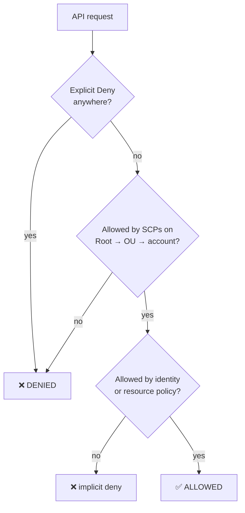

# Phase 5 — Guardrails: Rules Even Admins Can't Break

> **Mission:** attach organization policies so that certain actions are impossible in member accounts, whatever IAM says. (Controls **C2–C10, C15**)

[⬅ Phase 4](04-logging.md) · [Lab overview](../README.md) · [Phase 6 ➡](06-security-services.md)

---

## Why this matters

IAM answers *"what is this person allowed to do?"*. Organization policies answer *"what is anyone in this account ever allowed to do?"*. An account admin can grant themselves anything in IAM, but they can't get past an SCP.

## How AWS decides: SCPs in the evaluation



| Rule | Consequence |
|---|---|
| SCPs **never grant**; they only limit | You still need IAM permissions |
| `FullAWSAccess` is attached everywhere by default | Our SCPs are **deny lists** layered on top |
| SCPs **don't apply to the management account** | Test in member accounts only |
| Max **5 SCPs** per root, OU or account, including `FullAWSAccess`; max **5,120 characters** each | Group related rules into one policy |
| Service-linked roles are exempt | AWS services keep working |

## Three policy types, three jobs

| Type | Question it answers | Example here |
|---|---|---|
| **SCP** | *May this principal call this API?* | Deny `iam:CreateUser` in workload accounts |
| **Tag policy** | *Is this tag value allowed?* | `Project` ∈ {payments, analytics, shared} |
| **EC2 (declarative) policy** | *What is the account's EC2 configuration?* | IMDSv2 by default; public AMI sharing blocked. No API call can change it. |

---

## The policies

All in [`policies/`](../policies). Each `Sid` names its control.

```
Root ── FullAWSAccess · deny-leave-org (C6) · protect-baseline (C3 C4 C7 C15) · region-restriction (C5)   = 4/5
│       EC2 policy: ec2-baseline (C9)
├── Security ── (inherits Root)
├── Workloads ── workload-guardrails (C2 C8 C9 C10) · tag policy workload-tags (C10)
└── Suspended ── deny-all
```

| Policy | Highlights |
|---|---|
| [`protect-baseline`](../policies/scp/protect-baseline.json) | Denies **all** root activity (`ArnLike aws:PrincipalArn arn:aws:iam::*:root`); locks account BPA; blocks stop/delete on CloudTrail, Config, GuardDuty, Security Hub and Access Analyzer; makes `*-org-cloudtrail-*` immutable |
| [`region-restriction`](../policies/scp/region-restriction.json) | `Deny` + **`NotAction`** list of global services (IAM, STS, Organizations, Route 53, CloudFront, support, billing…) when `aws:RequestedRegion` ∉ {us-east-1, ap-south-1} |
| [`workload-guardrails`](../policies/scp/workload-guardrails.json) | No IAM users, keys or console passwords; no unencrypted volumes; `ec2:MetadataHttpTokens = required`; `aws:RequestTag/{Project,Environment,Owner}` must exist |

> [!IMPORTANT]
> **The `OrganizationAccountAccessRole` exemption.** C4, C5, C7 and C15 exempt this role. Only management-account admins can assume it, and they can detach SCPs anyway, so the exemption doesn't weaken anything. It gives Terraform and break-glass work a path that **people's** SSO roles don't have.

---

## Steps

1. **Turn on the settings the SCPs will lock**, in **every** account:
   - S3 → *Block Public Access settings for this account* → block all
   - EC2 → Settings → **EBS encryption** → *Always encrypt new volumes* (us-east-1 **and** ap-south-1)
2. **Enable the policy types:** Organizations → Policies → **Tag policies** → Enable; **EC2 policies** → Enable. (EC2 policies were called *Declarative policies* in older consoles; the API name is `DECLARATIVE_POLICY_EC2`.)
3. **Validate every SCP** before you create it:
   ```bash
   aws accessanalyzer validate-policy --policy-type SERVICE_CONTROL_POLICY --policy-document file://policies/scp/protect-baseline.json
   ```
4. **Root SCPs:** create `deny-leave-org`, `protect-baseline` and `region-restriction` → attach each to **Root**.
5. **Test `workload-guardrails` before using it:** Workloads is empty, so attach it to the **security account** temporarily, run the tests below, then detach it and attach it to **Workloads**.
6. **Tag policy** `workload-tags` → Workloads. **EC2 policy** `ec2-baseline` → Root. **SCP** `deny-all` → Suspended.

## Test it as the right principal, safely

Run tests as **an SSO user in the security account** (`--profile acme-security`). Pick calls that **change nothing** if the guardrail is missing.

| Control | Safe test | Result in this lab |
|---|---|---|
| C5 | `aws ec2 describe-vpcs --region eu-west-1` | 🛑 explicit deny in SCP |
| C4 | Re-apply the current account BPA (all `true`) | 🛑 |
| C15 | `delete-object --version-id <real-format id> --key <fake key> --bypass-governance-retention` | 🛑 |
| C15 | `put-bucket-policy` with the *current* policy | 🛑 |
| C7 | `guardduty delete-detector --detector-id <fake>` | 🛑 |
| C2 | `iam create-access-key --user-name <nonexistent>` | 🛑 |
| C10 | `ec2 run-instances --dry-run` without tags | 🛑 |
| C9 | The same with tags and explicit `HttpTokens=optional` | 🛑 |
| C8 | `ec2 create-volume --dry-run --no-encrypted` | 🛑 |
| ✅ | Tags + IMDSv2 + encrypted volume, `--dry-run` | `DryRunOperation` (would succeed) |
| C9 | `aws ec2 get-instance-metadata-defaults` | `ManagedBy: declarative-policy` |

---

## 🔥 Field notes

> [!WARNING]
> **Test with the wrong principal and every test passes.** SCPs don't apply to the management account or to the exempt break-glass role. The first verification scripts used `OrganizationAccountAccessRole` for read access. For **SCP tests** that would have proven nothing. Always test as a normal SSO user in the member account.

> [!WARNING]
> **Errors that hide the real answer.** S3 rejected a *malformed version ID* and a *wrong expected-bucket-owner* **before** checking permissions, so those "denials" weren't SCP denials. Look for the words **"explicit deny in a service control policy"** in the error.

> [!TIP]
> **AWS defaults can make a "bad" request compliant.** Launching without IMDS options was *allowed*: the Amazon Linux 2023 AMI has `ImdsSupport: v2.0`, so the instance would get IMDSv2 anyway. `Encrypted=false` was *allowed* because EBS default encryption overrode it. Test the **explicit** bad value instead.

> [!NOTE]
> **Access Analyzer caught a bug before AWS did.** It flagged `s3:DeleteAccountPublicAccessBlock` as a **non-existent action**. Deleting account BPA is authorized by `s3:PutAccountPublicAccessBlock`. It also recommended `ArnLike` over `StringLike` for `aws:PrincipalArn`.

> [!NOTE]
> **Tag policies only apply inside their OU.** `Project=foo` was allowed in the security account because `workload-tags` is attached to Workloads. You can only test it once a workload account exists.

---

## 🎤 Interview corner

<details><summary>Can an SCP grant permissions?</summary>

No. SCPs set the maximum permissions for an account. An action needs to be allowed by the SCPs *and* by an identity or resource policy. A Deny in any SCP wins.
</details>

<details><summary>Why use <code>NotAction</code> in the region SCP?</summary>

Global services (IAM, STS, Organizations, Route 53, CloudFront…) are called through `us-east-1` endpoints, or have no region. Without the `NotAction` exemptions, restricting regions would break sign-in and IAM.
</details>

<details><summary>How do you roll out a new SCP without breaking production?</summary>

Validate it with Access Analyzer. Attach it to a single test account or sandbox OU. Run safe, non-mutating tests as a normal principal. Check CloudTrail for unexpected `AccessDenied`. Only then attach it to the real OU. Keep a break-glass role exempted, and make sure Terraform uses it.
</details>

<details><summary>SCP vs permission boundary?</summary>

An SCP limits **every principal in an account** and is managed centrally by the org. A permission boundary limits **one IAM user or role** and is set inside the account. Both only restrict; neither grants.
</details>

---

**Terraform:** [`terraform/guardrails/`](../terraform/guardrails) reads the same JSON files. Targets are referenced by name (`Root`, `Workloads`, …), and a validation rule enforces the 5-SCP limit. The live policies were compared with the files: **identical**.

[⬅ Phase 4](04-logging.md) · [Lab overview](../README.md) · [Phase 6 ➡](06-security-services.md)
