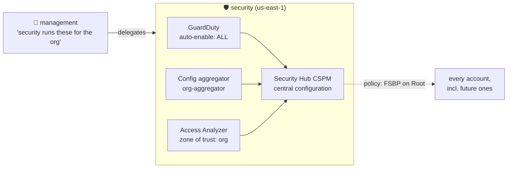

# Phase 6 — Security Services: One Console to See Everything

> **Mission:** the security account becomes the single place to see threats, posture, configuration and external access for **every** account, today and in the future. (Controls **C12, C13**)

[⬅ Phase 5](05-guardrails.md) · [Lab overview](../README.md) · [Phase 7 ➡](07-validation.md)

---

## Why this matters

With 50 accounts, nobody logs into each one to check GuardDuty. A **delegated administrator** is a member account that the management account trusts to run a service **for the whole organization**: it enables the service everywhere, sees every finding, and auto-enrolls new accounts. The management account stays empty, and the security team never needs access to it.



## The four services

| Service | Answers | Feeds on | Cost |
|---|---|---|---|
| **GuardDuty** | *Is someone attacking us?* (crypto-mining, credential theft, recon) | CloudTrail, VPC Flow Logs, DNS logs: read automatically, nothing to set up | 30-day trial, then ~$1–4/month |
| **AWS Config** | *What do we have, and how has it changed?* | A **recorder in every account** | Cents per configuration change |
| **Security Hub CSPM** | *How do we score against best practice?* Also collects every finding. | Config rules + other services' findings | 30-day trial, then per check |
| **IAM Access Analyzer** | *What can someone outside our org reach?* | Resource policies (roles, buckets, keys…) | External access: **free** |

> [!NOTE]
> **Security Hub vs Security Hub CSPM.** AWS renamed the original Security Hub (standards, controls, security score) to **Security Hub CSPM** and launched a newer *Security Hub* alongside it. This lab uses **CSPM**. Enabling the newer one can create a **paid** *unused access* analyzer (`_AccessAnalyzerForSecurityHubV2-…`). Watch for it.

---

## Steps (all in **us-east-1**: check the region selector before every click)

### 1 · Config recorders (in **each** account)
Config → Settings → Edit:
- **All resource types with customizable overrides**, no overrides, so IAM is included
- Continuous recording
- Create a bucket
- **No rules** (Security Hub adds the ones it needs)

> Record IAM (a global resource) in **one region per account**. Recording it in two accounts isn't duplication, because each account has its own IAM.

### 2 · Delegate to `security` (in **management**)

| Service | How |
|---|---|
| GuardDuty | GuardDuty → Settings → Delegated administrator → `<SECURITY_ID>` |
| Security Hub CSPM | Security Hub CSPM → Settings → General → Delegated administrator → `<SECURITY_ID>` |
| Access Analyzer | IAM → Access Analyzer → Analyzer settings → Delegated administrator |
| **Config** | **CLI only:** |

```bash
aws organizations enable-aws-service-access --service-principal config.amazonaws.com
aws organizations enable-aws-service-access --service-principal config-multiaccountsetup.amazonaws.com
aws organizations register-delegated-administrator --account-id <SECURITY_ID> --service-principal config.amazonaws.com
aws organizations register-delegated-administrator --account-id <SECURITY_ID> --service-principal config-multiaccountsetup.amazonaws.com
```

### 3 · Configure everything (in **security**)

**GuardDuty**
- Accounts → *Auto-enable preferences* → Edit → **Enable for all accounts**. (CLI: `update-organization-configuration --auto-enable-organization-members ALL`.)
- Protection plans: **off** for S3, EKS, Malware, RDS, Lambda and Runtime Monitoring. Foundational detection stays on.
- Settings → **Generate sample findings**. They're free fake findings you can explore.

**Security Hub CSPM: central configuration**
- Configuration → *Start central configuration* → home region us-east-1, **no linked regions**.
- Policy: Security Hub **enabled**, standards **FSBP only** (CIS adds more paid checks) → apply to **Root**.
- Central configuration means one policy decides for every account, including future ones.

**Config:** Aggregators → Create → *Add my organization* → us-east-1 → `org-aggregator`.

**Access Analyzer:** Create analyzer → **External access**, zone of trust **Current organization** → `org-external-access`.

**Archive rule** for expected findings: `org-external-access` → Archive rules → Create:

| Filter | Operator | Value |
|---|---|---|
| Resource type | equals | `AWS::IAM::Role` |
| Resource | contains | `/aws-reserved/sso.amazonaws.com/` |

## Verify

```bash
P=--profile=acme-security
aws organizations list-delegated-administrators --query 'DelegatedAdministrators[].Id'          # management creds
aws guardduty describe-organization-configuration $P --detector-id $(aws guardduty list-detectors $P --query 'DetectorIds[0]' --output text) \
  --query '{AutoEnable:AutoEnableOrganizationMembers,PaidOn:Features[?AutoEnable!=`NONE`].Name}'   # ALL, []
aws securityhub list-configuration-policy-associations $P --query 'ConfigurationPolicyAssociationSummaries[].[TargetId,AssociationStatus]'
aws securityhub get-findings $P --max-items 500 --query 'Findings[].[AwsAccountId,ProductName]' --output text | sort | uniq -c
aws configservice get-aggregate-discovered-resource-counts $P --configuration-aggregator-name org-aggregator --group-by-key ACCOUNT_ID
```
In this lab: delegated admin set for all 5 service principals, auto-enable `ALL` with no paid plans, every association `SUCCESS`, findings from **both** accounts, and the aggregator showing 141 + 120 resources.

---

## 🔥 Field notes

> [!CAUTION]
> **Wrong region, wrong account.** The first attempt enabled GuardDuty (with **every paid plan**) and Security Hub in the **management** account in **eu-west-1 (Ireland)**. The security account ended up with Security Hub (FSBP **+ CIS**) in **all 17 regions** and GuardDuty in 4 of them. Region-wide scans were the only way to see it all. **Check the region selector before every click.**

> [!WARNING]
> **Your guardrails block your own cleanup.** As an SSO admin in `security`, you can't even *open* eu-west-1 (C5), or disable GuardDuty or Security Hub (C7). Cleanup has to go through the exempt **break-glass role**: *Switch role* → `OrganizationAccountAccessRole` in `security`. The root user can't switch roles; use an SSO admin session in management.

> [!WARNING]
> **A delegated admin can't disable itself.** *Disable Security Hub* was **greyed out**, even for the break-glass role. The fix:
> 1. Management **removes** the delegated admin (for Security Hub, that's every region at once).
> 2. Disable in the unwanted regions.
> 3. Delegate again.

> [!NOTE]
> **Delegating again brought back the empty hubs.** Making `security` the Security Hub admin enabled the hub in **every region** of the admin account again. They have **no standards** and Config doesn't record there, so they run no checks and cost about **$0**. Removing them would mean removing the delegation, and they'd come back anyway. Accept them.

> [!TIP]
> **The "external access" that wasn't.** Access Analyzer's first findings were the Identity Center roles, because they trust the `AWSSSO_…` **SAML provider**, which is outside the org's zone of trust. That's expected, so an **archive rule** files it away automatically. Expected findings get archived; anything still *active* deserves a look.

> [!NOTE]
> **Central configuration needs the delegation first.** *Configuration → Accounts* was empty, and central configuration was refused, until Security Hub was delegated again.

---

## 🎤 Interview corner

<details><summary>What is a delegated administrator, and why not just use the management account?</summary>

It's a member account that Organizations allows to administer a service for the whole org. It keeps the management account minimal (SCPs don't protect it), separates duties (the security team doesn't need management access), and new accounts get auto-enrolled.
</details>

<details><summary>GuardDuty vs Security Hub vs Config?</summary>

GuardDuty **detects threats** from activity (CloudTrail, VPC Flow, DNS). Config **records configuration** and evaluates rules. Security Hub **scores posture** against standards (using Config) and **collects findings** from GuardDuty, Access Analyzer, Inspector and more into one view.
</details>

<details><summary>How do you make sure a new account is covered automatically?</summary>

GuardDuty org auto-enable = ALL, and a Security Hub central configuration policy on Root. Config needs a recorder in each account, through Control Tower, StackSets or Terraform, because Config has no org auto-enable.
</details>

<details><summary>What is Access Analyzer's "zone of trust"?</summary>

The boundary you call "inside": an account or the whole organization. Any resource policy granting access to a principal **outside** that boundary becomes a finding.
</details>

---

**Terraform:** [`terraform/security/`](../terraform/security) with two providers. Config recorders use the reusable module [`terraform/modules/config-recorder`](../terraform/modules/config-recorder) once per account. GuardDuty paid plans are pinned `DISABLED`/`NONE` in code.

[⬅ Phase 5](05-guardrails.md) · [Lab overview](../README.md) · [Phase 7 ➡](07-validation.md)
