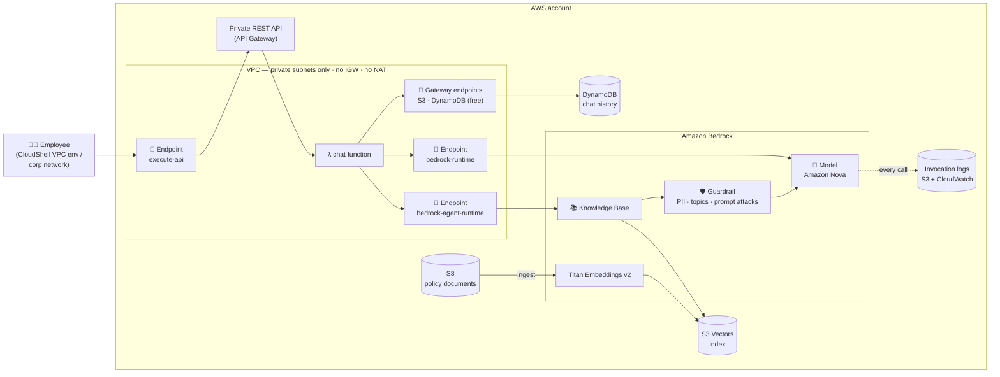

# Lab 2 — Private, Serverless GenAI Assistant on Amazon Bedrock

> **No internet. No servers. No data leaving the network.**
> Build an internal AI assistant that answers questions from company documents, where every call (user → API → Lambda → Bedrock) stays on the AWS private network. You build it in the console first, then as Terraform.

> [!NOTE]
> 🚧 **Status: in progress.** Phase 1 is built and verified. Phase 0 is waiting on Bedrock quotas. Phases 2–8 are written ahead of the build and get 🔥 field notes as they're built.

| | |
|---|---|
| **Level** | Intermediate. You know VPC and IAM basics. |
| **Accounts** | **1.** Any AWS account works, with or without AWS Organizations. |
| **Lab 1 needed?** | **No.** It runs on its own. If you built [Lab 1](../1/), you can deploy it into your landing zone instead (see [Two ways to run this lab](#-two-ways-to-run-this-lab)). |
| **Region** | `us-east-1` |
| **Cost** | About **$0.75/day** while the VPC endpoints exist, plus cents for model calls. Destroy the endpoints when you stop. |
| **Tools** | AWS console, AWS CLI v2, Terraform ≥ 1.10, Python 3.12 (Lambda) |

---

## 📖 The story

AcmeCorp's HR team wants **AcmeAssist**: employees ask *"How many days of parental leave do I get?"* and get an answer from the official policy PDFs, with sources.

The security team says yes, with conditions:

1. 🔒 **Private only.** The assistant must not be reachable from the internet, and no traffic to the model may cross the public internet.
2. 🧾 **Every prompt is auditable.** Who asked what, which model answered, when.
3. 🛡️ **No leaks, no jailbreaks.** Personal data (PII) in answers is masked, off-topic and harmful requests are refused, and prompt-injection attempts are blocked.
4. 💸 **Pay per use.** No always-on servers. If nobody uses it, it costs (almost) nothing.

---

## 🎯 What you'll be able to explain afterwards

- How a VPC with **no internet gateway and no NAT** can still use AWS services, and the difference between **gateway** and **interface** endpoints
- How a **private API** works, and how `aws:SourceVpce` locks an API, a role or a bucket to *your* network
- What **RAG** is, and how a Bedrock **Knowledge Base** turns documents into answers with citations
- What a **Guardrail** checks (PII, denied topics, prompt attacks, grounding), and why a system prompt alone isn't enough
- Why the Knowledge Base **isn't inside your VPC**, and what that means for policies
- What gets logged where (**CloudTrail** vs **model invocation logs**), and how to prove "private" with negative tests
- How each piece of a GenAI system is billed, and what to delete first ([plain-English guide](#-what-each-service-does-in-plain-english))

---

## 🔀 Two ways to run this lab

Lab 2 doesn't depend on Lab 1. Every phase works in a plain AWS account. If you already have the Lab 1 landing zone, the same steps run inside it, and you get extra protection for free.

| | 🅰️ Standalone | 🅱️ On top of Lab 1 |
|---|---|---|
| **Where** | Any single AWS account | A workload account in the **Workloads OU** (or the `security` account if your account quota is stuck at 2) |
| **Sign-in** | IAM Identity Center or an admin role you already use | Your Lab 1 SSO profile |
| **Audit** | CloudTrail trail + Bedrock invocation logs in this account | Already covered by the **org trail**; invocation logs can go to the locked bucket in `security` |
| **Threat detection** | Optional: enable GuardDuty yourself | Already on via GuardDuty and Security Hub delegated admin |
| **Budget** | Create one in Phase 0 | Lab 1 budget already covers it |
| **Extra things to know** | Nothing | Workload SCPs apply: no IAM users, tags on EC2, IMDSv2. The **region SCP** can block cross-region models (Phase 0 explains) |

Each phase guide marks the few steps that differ with **🅰️** or **🅱️**. Terraform takes an input such as `landing_zone = true` instead of separate code.

---

## 🏗️ Architecture



### One request, step by step

1. The employee calls `https://<api-id>-<vpce-id>.execute-api.us-east-1.amazonaws.com/prod/chat` from inside the VPC.
2. The **execute-api endpoint** carries it to the **private API**. The API's resource policy rejects anything that didn't come through that endpoint.
3. API Gateway invokes **Lambda**, which runs inside the private subnets.
4. Lambda calls **`RetrieveAndGenerate`** through the **bedrock-agent-runtime endpoint**:
   - the Knowledge Base finds the relevant policy chunks in the **S3 Vectors** index
   - the **Guardrail** checks the prompt and the answer
   - **Amazon Nova** writes the answer, with citations
5. Lambda saves the turn to **DynamoDB** through the free gateway endpoint and returns the answer.
6. Bedrock writes the full prompt and response to the **invocation logs**. CloudTrail records the API calls.

### Why these choices

| Choice | Why | Cheaper/simpler than |
|---|---|---|
| **Private REST API** | Only reachable through a VPC endpoint; resource policy enforces it | A public API with WAF and auth bolted on |
| **Lambda in a VPC with no NAT** | No route to the internet exists, so nothing can leak out by accident | NAT Gateway (~$33/month + data) |
| **Interface endpoints in 1 AZ** | Private path to Bedrock; 1 AZ keeps it at $0.01/hour each | 2–3 AZs (production would use 2+) |
| **Gateway endpoints for S3 + DynamoDB** | Private and **free** | Interface endpoints for the same services |
| **Bedrock Knowledge Base** | Managed RAG: chunking, embeddings, retrieval, citations | Writing your own RAG pipeline |
| **S3 Vectors** as the vector store | Pay per GB and per query; no cluster | OpenSearch Serverless (~$170+/month minimum) |
| **Amazon Nova Micro/Lite** | Available on demand in `us-east-1`, very cheap per token | Larger models; cross-region-only models (see lesson below) |
| **DynamoDB on demand** | Serverless, free tier covers the lab | RDS |

---

## 🧩 What each service does, in plain English

Picture AcmeAssist as an **HR help desk inside a building with no doors to the street**. Staff inside can walk up and ask questions; nobody outside can even find the desk. Every service answers one of four questions:

> **How do we stay off the internet?** · **How does it know the answers?** · **How do we keep it safe?** · **How do we prove what happened?**

### 🔒 The private network: *how do we stay off the internet?*

**VPC with no internet gateway and no NAT: a building with no street doors.**
A VPC is your own private network in AWS. Normally you add an *internet gateway* (a front door) or a *NAT gateway* (a back door for going out). We add neither. With no route to `0.0.0.0/0`, nothing inside can reach the internet and nothing outside can reach in, even by mistake.

**Route tables and subnets: the signs in the corridors.**
A subnet is "private" only because of its route table. Ours knows just one destination, `local` (the rest of the building), plus the private doors below.

**Security groups: the guard at each room.**
Firewalls on each network card. The Lambda's group may only go *out* on HTTPS to the endpoints. The endpoints' group only lets the Lambda *in*. We delete the default "allow everything out" rule so this is actually true.

**Gateway endpoints (S3, DynamoDB): free private corridors.**
A route-table entry that sends S3 and DynamoDB traffic over Amazon's own network. Free, no device to manage. Only these two services have them.

**Interface endpoints (PrivateLink): private service counters inside your building.**
For Bedrock and API Gateway there's no corridor, so AWS puts a network card with a **private IP** in your subnet. With private DNS on, `bedrock-runtime.us-east-1.amazonaws.com` points at that private IP, so code doesn't change. They cost about $0.01/hour each, which is why we delete them when idle. Each can carry an **endpoint policy**: "this door only works for Nova Micro".

### 🧠 The brain: *how does it know the answers?*

**Amazon Bedrock: a menu of AI models, served by AWS.**
You call a model through an API and pay per token. No GPUs, no servers. Your prompts aren't used to train the models.

**Amazon Nova Micro: the one who writes the answer.**
A small, fast, very cheap text model. Good enough to read a few policy paragraphs and answer clearly.

**Titan Text Embeddings V2: the librarian who files by meaning.**
Turns a piece of text into 1,024 numbers that capture what it *means*. "Parental leave" and "time off for a new baby" end up close together, even with different words.

**S3 Vectors: the filing cabinet for those numbers.**
Stores the embeddings and finds the nearest ones fast. Pay per GB and per query, with no cluster running all month.

**Knowledge Base: the research assistant (RAG).**
Does the whole job for you: reads the docs from S3, cuts them into chunks, embeds them, stores them, and at question time finds the best chunks and asks Nova to answer *only from those*, with **citations**. This is **RAG** (retrieval-augmented generation): look it up first, then answer.

### 🛡️ Safety: *how do we keep it safe?*

**Bedrock Guardrail: the editor who checks every question and every answer.**
- **Content filters** block hate, violence and misconduct.
- **Prompt-attack filter** catches "ignore your instructions and…".
- **Denied topics** refuse things HR shouldn't answer (legal advice, salary negotiations).
- **PII masking** hides emails and phone numbers in answers.
- **Contextual grounding** blocks answers the documents don't support (made-up facts).

**IAM role and `aws:SourceVpce`: a badge that only works inside the building.**
The Lambda's role may call Bedrock *only* through our endpoints. Stolen credentials used from a laptop get denied.

### ⚙️ The help desk itself

**API Gateway (private REST API): the reception window.**
The one place employees send questions. *Private* means it has no public address: it's only reachable through the `execute-api` endpoint, and its resource policy rejects anything else.

**Lambda: the clerk.**
Runs our Python code only when a question arrives, then stops. It sits in the private subnets, calls the Knowledge Base, saves the conversation and returns the answer.

**DynamoDB: the logbook of conversations.**
A serverless database that stores each question and answer with who asked it. On-demand billing, so idle costs nothing.

**CloudShell VPC environment: an employee's desk inside the building.**
A browser terminal placed *inside* our VPC, so we can test the private API the way an internal user would.

### 📼 Proof: *how do we prove what happened?*

**Model invocation logging: the full transcript.**
Bedrock writes every prompt and response (and which model, and the guardrail result) to S3 and CloudWatch Logs.

**CloudTrail: the visitor log.**
Records *who* called *which* API and when, including the endpoint they came through. It doesn't store the prompt text; the invocation log does.

**AWS Budgets: the smoke detector for your wallet.**
Emails you before a forgotten endpoint turns into a surprise bill.

### 🔗 How it all fits together

```
Employee (inside VPC)
  → execute-api endpoint → private API → Lambda
      → bedrock-agent-runtime endpoint → Knowledge Base → S3 Vectors (find chunks)
                                        → Guardrail → Nova Micro (answer + citations)
      → DynamoDB gateway endpoint → chat history
  Every model call → invocation logs · Every API call → CloudTrail
```

**In one breath (interview answer):** *"A private API behind an execute-api endpoint triggers a Lambda in a VPC with no internet. It calls a Bedrock Knowledge Base through PrivateLink for RAG over S3 Vectors, with a Guardrail on every call. `aws:SourceVpce` conditions lock the API and the Bedrock calls to our endpoints, and invocation logs plus CloudTrail record everything."*

---

## ✅ Security controls

| # | Control | Enforced by |
|---|---|---|
| G1 | No internet path in or out | VPC with no IGW and no NAT; Lambda in private subnets |
| G2 | API reachable only through our VPC endpoint | API resource policy: `aws:SourceVpce` |
| G3 | Bedrock callable only through our VPC endpoint | Lambda role condition `aws:SourceVpce` + endpoint policy |
| G4 | Only approved models can be used | Endpoint policy and IAM allow specific model ARNs only |
| G5 | PII masked, denied topics refused, prompt attacks blocked | Bedrock Guardrail attached to every call |
| G6 | Every prompt and answer is auditable | Bedrock model invocation logging + CloudTrail |
| G7 | Least privilege | One role per component; no `*` actions |
| G8 | Runaway cost is capped | API throttling + usage plan, Lambda reserved concurrency, AWS Budgets alert |
| G9 | Data encrypted at rest and in transit | TLS only (`aws:SecureTransport`), SSE on S3 / DynamoDB / S3 Vectors |

---

## 🗺️ The journey

Each phase has its own guide: mission, why it matters, concepts, steps, verify, known gotchas, 🔥 field notes and a 🎤 interview corner.

| Phase | Guide | What you build | Status |
|---|---|---|---|
| 0 | [Prep](docs/00-prep.md) | Pick 🅰️/🅱️, account, Bedrock quotas, smoke test | ⏳ waiting on Bedrock quota |
| 1 | [Network](docs/01-network.md) | VPC with no IGW/NAT, private subnets, SGs, S3 + DynamoDB gateway endpoints | ✅ done (2026-11-22) |
| 2 | [Private endpoints](docs/02-private-endpoints.md) | `bedrock-runtime`, `bedrock-agent-runtime`, `execute-api` + endpoint policies | 📝 planned |
| 3 | [Knowledge Base](docs/03-knowledge-base.md) | Docs bucket, S3 Vectors, Titan Embeddings, sync | 📝 planned |
| 4 | [Guardrail](docs/04-guardrail.md) | Content + prompt-attack filters, denied topics, PII masking, grounding | 📝 planned |
| 5 | [API + Lambda](docs/05-api-lambda.md) | VPC Lambda, private REST API (IAM auth), DynamoDB history | 📝 planned |
| 6 | [Audit](docs/06-audit.md) | Model invocation logging, CloudTrail, dashboard | 📝 planned |
| 7 | [Validate](docs/07-validation.md) | 17 positive and negative tests | 📝 planned |
| 8 | [Cleanup](docs/08-cleanup.md) | Daily pause (endpoints only) or full teardown | 📝 planned |

> [!TIP]
> Phase 1 is free, so build it any time. Phase 2's interface endpoints cost about $0.72/day and do nothing until Bedrock works. Create them on the day you build Phases 3–5, and delete them at the end of each day.

### What each phase teaches

| Phase | You'll learn |
|---|---|
| 0 · Prep | Bedrock model access and quotas, "AccessDenied" vs "Operation not allowed", why region SCPs matter for Bedrock |
| 1 · Network | Route tables decide "private", gateway vs interface endpoints, prefix lists, locking down security-group egress |
| 2 · Private endpoints | PrivateLink, private DNS, endpoint policies as a second permission layer |
| 3 · Knowledge Base | RAG, chunking, embeddings, vector search, citations |
| 4 · Guardrail | How guardrails check input and output, PII masking, prompt-attack filters, grounding |
| 5 · API + Lambda | Private APIs, `aws:SourceVpce`, Lambda networking (ENIs), SigV4-signed calls |
| 6 · Audit | What gets logged where: CloudTrail vs model invocation logs |
| 7 · Validate | Proving "private" with negative tests instead of assuming it |
| 8 · Cleanup | Cost-aware teardown: pause (endpoints only) vs finish |

---

## 🧰 Prerequisites

- [ ] An AWS account on the **Paid plan** (credits are fine). 🅱️ path: a workload account in Lab 1's Workloads OU.
- [ ] **Bedrock on-demand quotas above 0** for Nova Micro and Titan Text Embeddings V2 in `us-east-1`. New accounts often start at 0 and *not adjustable*. Phase 0 shows how to check and what to ask Support.
- [ ] An admin sign-in: IAM Identity Center (recommended) or an admin role
- [ ] AWS CLI v2, Terraform ≥ 1.10, Python 3.12
- [ ] Comfortable with VPC basics (CIDR, subnets, route tables) and IAM policies

---

## 🔥 Lessons this lab is designed to teach

- **"Private" needs proof.** The test suite calls the API from outside the VPC and calls Bedrock from outside the endpoint, and expects both to fail.
- **Lambda logs don't need a `logs` endpoint.** The Lambda service ships logs itself, so a VPC Lambda with no internet still logs. Your *code's* AWS calls are what need endpoints.
- **Region SCPs vs cross-region inference** *(Lab 1 path)*. Many newer models are only offered through *inference profiles* that route to other regions. A region-restriction SCP like Lab 1's can block those calls even though you called `us-east-1`. Phase 0 shows how to spot it and how to fix it properly.
- **The Knowledge Base isn't in your VPC.** Ingestion and retrieval run inside Bedrock. Your VPC endpoint protects *your* call to Bedrock, not Bedrock's own access to S3, which is controlled by the bucket policy.

---

## 💰 Cost (us-east-1, estimate)

| Item | Price | Lab estimate |
|---|---|---|
| 3 interface endpoints × 1 AZ | $0.01/hour each + $0.01/GB | ~$0.72/day → **destroy when idle** |
| Bedrock Nova Micro / Lite | ~$0.035–0.06 per 1M input tokens | < $0.10 |
| Titan Embeddings v2 | $0.02 per 1M tokens | < $0.01 |
| Guardrail | per 1,000 text units | < $0.20 for a few hundred tests |
| S3 Vectors, S3, DynamoDB, Lambda, API Gateway | Free tier / per request | ≈ $0 |
| **Total for a weekend of building** | | **≈ $2–3** |

> [!WARNING]
> The VPC endpoints are the only thing that costs money while idle. Terraform keeps them in a separate stack so you can `destroy` them in one command and recreate them later.

---

## 🚀 Stretch goals

- **Bedrock Agent** with an action group (e.g. "how many leave days do *I* have left?" via a Lambda tool)
- **Response streaming** for a chat-like experience
- **Cross-account audit** *(Lab 1 path)*: ship invocation logs to the security account's locked bucket
- **Identity-aware answers:** pass the caller's identity to filter documents by department (metadata filtering)

---

## 🏗️ Terraform

*Planned.* Written after the console build, one stack per layer, each with its own state file, so the paid part can be destroyed on its own:

```
terraform/
├── network/          VPC, subnets, route table, SGs, gateway endpoints   ($0)
├── endpoints/        3 interface endpoints + endpoint policies           (the only idle cost: destroy daily)
├── knowledge-base/   docs bucket, S3 Vectors, Knowledge Base, data source
├── app/              DynamoDB, Lambda + role, private API, guardrail
└── audit/            invocation-log bucket, log group, logging config
```

🅱️ path: `landing_zone = true` skips what Lab 1 already provides (budget, org trail).

---

## 📁 Folder layout

```
2/
├── README.md        ← you are here
├── docs/            one guide per phase
├── policies/        endpoint, IAM, API and bucket policies (JSON templates)
├── app/chat/        Lambda handler + test event
├── sample-docs/     fictional AcmeCorp HR policies for the Knowledge Base
└── terraform/       (planned) network · endpoints · knowledge-base · app · audit
```

[All labs](../README.md) · [Lab 1: landing zone (optional base)](../1/README.md)
