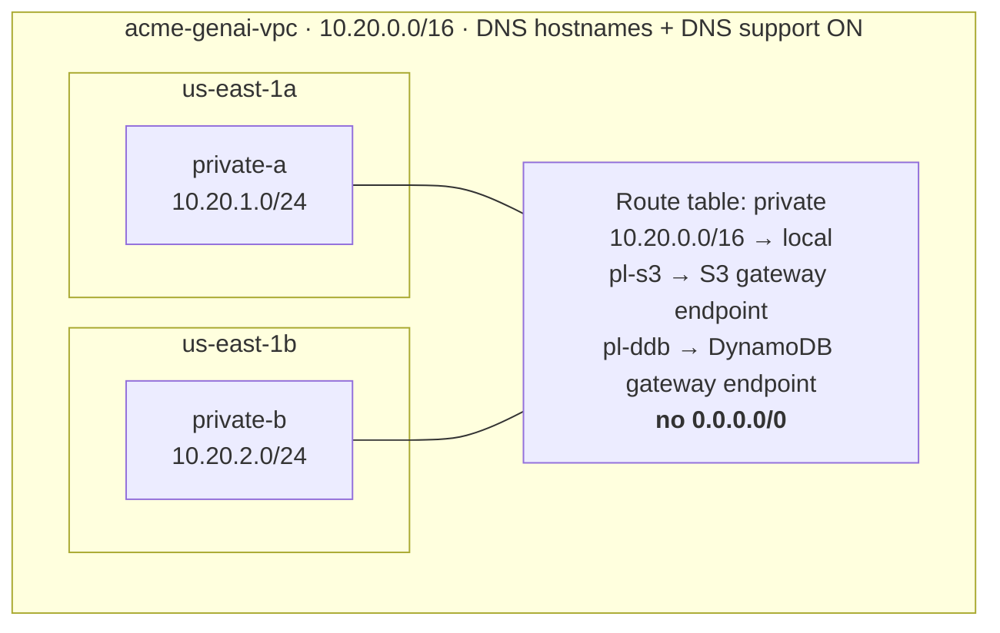

# Phase 1 — Network: A VPC With No Way Out

> **Mission:** build a VPC that has **no route to the internet**, in or out, and give it free private paths to S3 and DynamoDB. (Control **G1**)

[⬅ Phase 0](00-prep.md) · [Lab overview](../README.md) · [Phase 2 ➡](02-private-endpoints.md)

> [!NOTE]
> ✅ **Built by hand in the console and verified 2026-11-22** in `genai-dev`: 0 IGWs, 0 NATs, no `0.0.0.0/0` route, both gateway endpoints `available` with `pl-` routes in `acme-genai-private-rt`.

---

## Why this matters

The easiest way to guarantee that data can't leak to the internet is to make sure **there is no internet**. No internet gateway, no NAT gateway, no public IPs. Everything the Lambda needs (Bedrock, DynamoDB) is reached through **VPC endpoints** instead.



## Concepts in 30 seconds

- **No IGW + no NAT = no internet.** A subnet is "private" only because of its route table. With no `0.0.0.0/0` route anywhere, nothing in the VPC can reach the internet, and nothing on the internet can reach in.
- **Gateway endpoint:** a route-table entry that sends S3 or DynamoDB traffic over the AWS network. **Free.** Only S3 and DynamoDB have them.
- **Interface endpoint (PrivateLink):** an ENI with a private IP in your subnet for any other service. **Paid** (Phase 2).
- **Security groups for Lambda:** a VPC Lambda gets ENIs in your subnets. Its security group needs **outbound 443** only to the endpoints; no inbound rules at all.

> [!NOTE]
> **Cost:** $0. VPCs, subnets, route tables, security groups and gateway endpoints are free.

---

## Steps

All in **us-east-1**: check the region selector (top right) and the account name before every click. Add the tag `Project = acme-genai` to everything you create; Phase 8 cleanup filters on it.

### 1 · VPC
VPC console → **Your VPCs → Create VPC**:

| Setting | Value | Why |
|---|---|---|
| Resources to create | **VPC only** | "VPC and more" adds an internet gateway and public subnets |
| Name tag | `acme-genai-vpc` | Later phases look it up by name |
| IPv4 CIDR | `10.20.0.0/16` | Room for many /24 subnets; doesn't overlap the default VPC (172.31.0.0/16) |
| IPv6 | No IPv6 CIDR block | IPv6 needs its own egress controls; out of scope |
| Tenancy | Default | Dedicated costs extra |

Then select the VPC → **Actions → Edit VPC settings** → tick **Enable DNS resolution** and **Enable DNS hostnames** → *Save*. Interface endpoints' private DNS (Phase 2) needs both.

### 2 · Subnets
**Subnets → Create subnet** → VPC `acme-genai-vpc` → add two subnets:

| Name | AZ | CIDR | Why |
|---|---|---|---|
| `acme-genai-private-a` | us-east-1a | `10.20.1.0/24` | Interface endpoints live here (1 AZ keeps cost down) |
| `acme-genai-private-b` | us-east-1b | `10.20.2.0/24` | Lambda runs in two AZs for availability |

Leave **auto-assign public IPv4** off (the default). A public IP is useless without an internet gateway, but keeping it off is one less thing to explain to an auditor.

### 3 · Route table
**Route tables → Create route table**: name `acme-genai-private-rt`, VPC `acme-genai-vpc`.

Then select it → **Subnet associations → Edit subnet associations** → tick **both** subnets → *Save*.

| Route | Target | Why |
|---|---|---|
| `10.20.0.0/16` | `local` | Created automatically; traffic inside the VPC |
| *(nothing else)* | | No `0.0.0.0/0` route = no internet. That's the point. |

> Creating the route table doesn't attach it to anything. Without the explicit association, the subnets use the VPC's **main** route table, and the gateway endpoints in step 5 won't apply to them.

### 4 · Security groups
**Security groups → Create security group**. Create **both** groups first, with no rules, because each one's rule points at the other. Then edit the rules.

| Name | Inbound | Outbound | Used by |
|---|---|---|---|
| `acme-genai-lambda-sg` | *none* | HTTPS 443 → `acme-genai-endpoints-sg`<br/>HTTPS 443 → prefix list S3 (`pl-63a5400a`)<br/>HTTPS 443 → prefix list DynamoDB (`pl-02cd2c6b`) | Lambda, CloudShell VPC env |
| `acme-genai-endpoints-sg` | HTTPS 443 from `acme-genai-lambda-sg` | *none* | Interface endpoints (Phase 2) |

1. Create `acme-genai-lambda-sg` and `acme-genai-endpoints-sg` in `acme-genai-vpc`.
2. On **both**, open **Outbound rules → Edit** and **delete** the default rule *All traffic → 0.0.0.0/0*. Every new group gets it, and leaving it quietly undoes the "443 to endpoints only" design.
3. `acme-genai-endpoints-sg` → **Inbound rules → Edit** → HTTPS, source = `acme-genai-lambda-sg`.
4. `acme-genai-lambda-sg` → **Outbound rules → Edit** → HTTPS, destination = `acme-genai-endpoints-sg`.
5. The two prefix-list rules are easier **after step 5**: once the gateway endpoints exist, type `pl-` or `com.amazonaws.us-east-1.s3` in the destination box. Prefix-list IDs differ per region; look yours up under **VPC → Managed prefix lists**.

> Why outbound 443 to S3/DynamoDB *prefix lists* and not to the gateway endpoint? A gateway endpoint isn't a network card, so it has no security group. Traffic goes to S3's public IP ranges and the route table steers it into the endpoint. The prefix list is how a security group names "S3's IP ranges in this region".

### 5 · Gateway endpoints (free)
**Endpoints → Create endpoint**, twice:

| Setting | S3 | DynamoDB |
|---|---|---|
| Name | `acme-genai-s3-gw` | `acme-genai-dynamodb-gw` |
| Type | AWS services | AWS services |
| Service | `com.amazonaws.us-east-1.s3` with type **Gateway** | `com.amazonaws.us-east-1.dynamodb` (Gateway) |
| VPC | `acme-genai-vpc` | `acme-genai-vpc` |
| Route tables | ✅ `acme-genai-private-rt` | ✅ `acme-genai-private-rt` |
| Policy | Full access (for now) | Full access (Phase 2 tightens it) |

> Searching `s3` shows **two** entries with the same name: one **Gateway** (free) and one **Interface** (paid). Check the *Type* column.

Then go back to step 4.5 and add the prefix-list rules.

### ✅ Console check

- [ ] **Your VPCs:** `acme-genai-vpc`, DNS resolution and DNS hostnames **Enabled**
- [ ] **Internet gateways / NAT gateways:** nothing attached to `acme-genai-vpc`
- [ ] **Route tables → acme-genai-private-rt → Subnet associations:** both subnets
- [ ] **Route tables → acme-genai-private-rt → Routes:** `local`, plus `pl-63a5400a → vpce-…` and `pl-02cd2c6b → vpce-…`, all **Active**; no `0.0.0.0/0`
- [ ] **Security groups:** lambda-sg has no inbound and 3 outbound rules (all 443); endpoints-sg has 1 inbound and **no** outbound
- [ ] **Endpoints:** both gateway endpoints **Available**

## Verify (CLI)

```bash
VPC=$(aws ec2 describe-vpcs --filters Name=tag:Name,Values=acme-genai-vpc --query 'Vpcs[0].VpcId' --output text)
aws ec2 describe-internet-gateways --filters Name=attachment.vpc-id,Values=$VPC --query 'length(InternetGateways)'   # 0
aws ec2 describe-nat-gateways --filter Name=vpc-id,Values=$VPC --query 'length(NatGateways)'                        # 0
aws ec2 describe-route-tables --filters Name=vpc-id,Values=$VPC \
  --query 'RouteTables[].Routes[].[DestinationCidrBlock,DestinationPrefixListId,GatewayId]' --output table         # no 0.0.0.0/0
aws ec2 describe-vpc-endpoints --filters Name=vpc-id,Values=$VPC --query 'VpcEndpoints[].[ServiceName,VpcEndpointType,State]' --output table
```

---

## ⚠️ Known gotchas

- **The default VPC has an internet gateway.** Never place lab resources in it. 🅱️ Optional: delete the default VPCs in `genai-dev` so nothing lands there by accident.
- **Gateway endpoints only work from inside the VPC** and only for the same region.

## 🔥 Field notes

- **Every new security group has an allow-all outbound rule.** Removing it on both groups is what makes the Lambda SG "443 to endpoints only". Check `IpPermissionsEgress` afterwards: lambda-sg should show only tcp/443 to the endpoints SG and the two `pl-` prefix lists, and endpoints-sg should show nothing.
- **The VPC's main route table also has only `local`.** It's unused (both subnets are associated with `acme-genai-private-rt`), but it's good to confirm a new subnet can't pick up an internet route by default.
- **Bedrock and execute-api endpoints are offered in all six us-east-1 AZs**, so 1a/1b work for Phase 2. Check with `aws ec2 describe-vpc-endpoint-services --service-names com.amazonaws.us-east-1.bedrock-runtime --query 'ServiceDetails[0].AvailabilityZones'` before picking AZs in another region.
- **zsh tip:** quote filter values that contain `*` (`'Name=group-name,Values=acme-genai-*'`), or zsh tries to glob them and fails with "no matches found".
- Tag everything `Project=acme-genai`, which makes cleanup (Phase 8) a single filter.
- **Associate the subnets with the route table explicitly.** Creating `acme-genai-private-rt` doesn't attach it to anything: the subnets silently fall back to the VPC's main route table, and gateway endpoints attached to the private RT then don't apply to them. Check *Route table → Subnet associations* shows both subnets.
- **Create the gateway endpoints before adding the prefix-list rules.** The S3/DynamoDB prefix lists are easy to find in the SG destination box once the endpoints exist. When creating the S3 endpoint, pick the **Gateway** type: the same service name is also offered as an (paid) Interface endpoint.
- **How to tell it worked:** the route table gains two routes, `pl-63a5400a → vpce-…` (S3) and `pl-02cd2c6b → vpce-…` (DynamoDB), both `active`.

---

## 🎤 Interview corner

<details><summary>Gateway endpoint vs interface endpoint?</summary>

A **gateway endpoint** is a route-table target, only for S3 and DynamoDB, and free. An **interface endpoint** is an ENI with a private IP and optional private DNS, works for most services (and for S3 too), is reachable from on-prem over VPN/Direct Connect, and costs per hour per AZ plus per GB.
</details>

<details><summary>How do you prove a subnet has no internet access?</summary>

Check its route table for any `0.0.0.0/0` (or `::/0`) route to an IGW, NAT gateway, transit gateway or firewall; check the VPC has no IGW; and test from inside (e.g. `curl https://example.com` times out). Reachability Analyzer can prove it formally.
</details>

---

**Terraform:** planned stack `terraform/network/`.

[⬅ Phase 0](00-prep.md) · [Lab overview](../README.md) · [Phase 2 ➡](02-private-endpoints.md)
