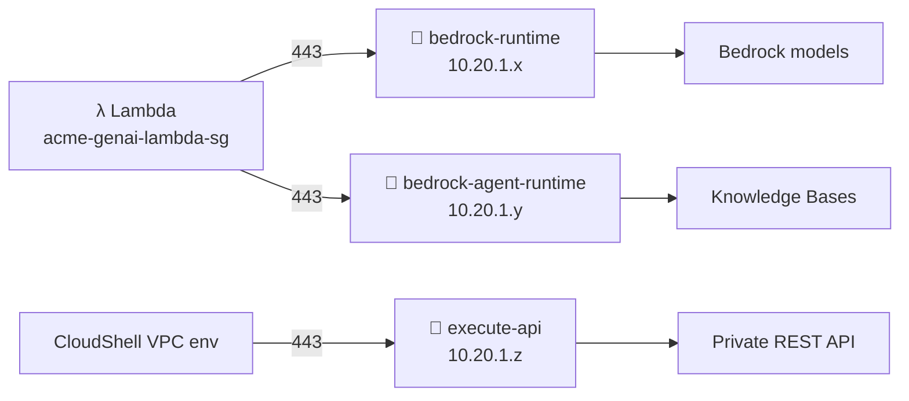

# Phase 2 — Private Endpoints: Bedrock Without the Internet

> **Mission:** give the VPC private doors to Bedrock and API Gateway, and lock those doors so they only open for **our** resources. (Controls **G3**, **G4**)

[⬅ Phase 1](01-network.md) · [Lab overview](../README.md) · [Phase 3 ➡](03-knowledge-base.md)

> [!NOTE]
> 📝 **Planned.** Steps are written ahead of the build and will be verified (with field notes) as it happens.

---

## Why this matters

With no internet, the Lambda can't reach `bedrock-runtime.us-east-1.amazonaws.com`, unless that name resolves to a **private IP inside the VPC**. That's what an interface endpoint with **private DNS** does. Then two policies make it a real control:
- the **endpoint policy** says *what* can go through the door (which actions, which models)
- the **IAM role** says the Lambda may *only* use Bedrock through that door (`aws:SourceVpce`)



## Concepts in 30 seconds

- **Private DNS:** with it on, the normal public hostname (e.g. `bedrock-runtime.us-east-1.amazonaws.com`) resolves to the endpoint's private IP **inside this VPC**. SDKs work unchanged.
- **Endpoint policy:** a resource policy on the endpoint. It **filters**; it never grants. The default is "allow everything".
- **`aws:SourceVpce`:** a condition key set when a request comes through a specific endpoint. Use it in IAM or resource policies to say "only via this endpoint".
- **`aws:ViaAWSService`:** `true` when an AWS service makes a call **on your behalf** (e.g. the Knowledge Base calling the model for `RetrieveAndGenerate`). Those calls don't come through your endpoint, so `aws:SourceVpce` deny rules must exempt them.

> [!WARNING]
> **Cost:** each interface endpoint is **$0.01/hour per AZ** (~$7.30/month) + $0.01/GB. Three endpoints in **one AZ** ≈ **$0.72/day**. Delete them when you stop for the day (Terraform makes recreating them one command).

---

## Steps

### 1 · Interface endpoints (subnet `private-a` only, SG `acme-genai-endpoints-sg`, private DNS **on**)

| Endpoint | Service name | Used by |
|---|---|---|
| Bedrock runtime | `com.amazonaws.us-east-1.bedrock-runtime` | Converse / InvokeModel |
| Bedrock agent runtime | `com.amazonaws.us-east-1.bedrock-agent-runtime` | Knowledge Base `RetrieveAndGenerate` |
| API Gateway | `com.amazonaws.us-east-1.execute-api` | Calling the private API |

> One AZ is a **lab** choice. Production uses one subnet per AZ (2–3) so an AZ outage doesn't take the endpoints down.

### 2 · Endpoint policies
Replace *Full access* with the templates (fill in `<ACCOUNT_ID>`):
- bedrock-runtime → [`policies/endpoints/bedrock-runtime.json`](../policies/endpoints/bedrock-runtime.json): only our account's principals, only `InvokeModel`/`Converse`, only the approved model ARNs (**G4**)
- bedrock-agent-runtime → [`policies/endpoints/bedrock-agent-runtime.json`](../policies/endpoints/bedrock-agent-runtime.json): only `Retrieve`/`RetrieveAndGenerate`, only our account
- DynamoDB gateway → [`policies/endpoints/dynamodb.json`](../policies/endpoints/dynamodb.json): only the chat-history table

The execute-api endpoint stays at full access; the **API's resource policy** (Phase 5) does the filtering.

### 3 · Write down the endpoint IDs
Phase 5 needs them for the Lambda role and the API resource policy:
```bash
aws ec2 describe-vpc-endpoints --filters Name=vpc-id,Values=$VPC \
  --query 'VpcEndpoints[].[ServiceName,VpcEndpointId]' --output table
```

## Verify

```bash
# private DNS: from inside the VPC (CloudShell VPC env, Phase 5) these resolve to 10.20.x.x
getent hosts bedrock-runtime.us-east-1.amazonaws.com
getent hosts bedrock-agent-runtime.us-east-1.amazonaws.com
```

---

## ⚠️ Known gotchas

- **Private DNS needs both VPC DNS settings** (Phase 1, step 1); the console refuses otherwise.
- **execute-api private DNS changes every API URL in the VPC.** With it on, `*.execute-api.us-east-1.amazonaws.com` always goes to the endpoint, so **public** APIs become unreachable from this VPC. Fine here (there's no internet anyway).
- **`bedrock` ≠ `bedrock-runtime`.** `com.amazonaws.us-east-1.bedrock` is the control plane (create guardrails, list models). The Lambda only needs the runtime endpoints.

## 🔥 Field notes

*Added during the build.*

---

## 🎤 Interview corner

<details><summary>Does an endpoint policy grant permissions?</summary>

No. A request must be allowed by the **identity policy** (and resource policy where relevant) **and** not denied by the endpoint policy, SCPs or permission boundaries. The endpoint policy only narrows what can pass through it.
</details>

<details><summary>How do you force a Lambda to call Bedrock only through a VPC endpoint?</summary>

Add a Deny to its role: Bedrock actions where `aws:SourceVpce` is not your endpoint ID **and** `aws:ViaAWSService` is false. The second condition keeps service-to-service calls working (a Knowledge Base calling the model on your behalf doesn't travel through your endpoint).
</details>

---

**Terraform:** planned stack `terraform/endpoints/`, kept separate so `terraform destroy` removes only the paid part.

[⬅ Phase 1](01-network.md) · [Lab overview](../README.md) · [Phase 3 ➡](03-knowledge-base.md)
