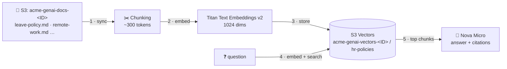

# Phase 3 — Knowledge Base: Teach It the Handbook

> **Mission:** turn AcmeCorp's HR policy documents into a searchable **vector index** that Bedrock can use to answer questions, with sources. (RAG)

[⬅ Phase 2](02-private-endpoints.md) · [Lab overview](../README.md) · [Phase 4 ➡](04-guardrail.md)

> [!NOTE]
> 📝 **Planned.** Needs working Bedrock quotas (Phase 0) for Titan Embeddings and Nova.

---

## Why this matters

A model knows nothing about AcmeCorp. Fine-tuning is slow and expensive, and goes stale when a policy changes. **RAG** (retrieval-augmented generation) is the usual answer: find the relevant paragraphs first, then give them to the model with the question. A Bedrock **Knowledge Base** does the whole pipeline for you.



## Concepts in 30 seconds

- **Embedding:** a list of numbers (here 1024) that captures meaning. Texts with similar meaning have nearby vectors.
- **Chunking:** documents are split into pieces before embedding. Too big = vague matches; too small = missing context.
- **Vector store:** a database that finds the nearest vectors fast. **S3 Vectors** is S3-priced storage for vectors: no cluster, pay per GB and per query.
- **Sync (ingestion job):** reads the S3 data source, chunks, embeds and writes vectors. Re-run it whenever documents change.
- **`RetrieveAndGenerate`:** one API call that searches the index and asks the model to answer *only* from the retrieved chunks, returning **citations**.

> [!NOTE]
> **Cost:** cents. Embedding the sample docs is a few thousand tokens ($0.02 per 1M). S3 Vectors storage for this size is ≈ $0.

---

## Steps

### 1 · Documents bucket
S3 → create `acme-genai-docs-<ACCOUNT_ID>`: Block Public Access **on**, bucket owner enforced, SSE-S3, versioning on, bucket policy [`policies/s3/docs-bucket.json`](../policies/s3/docs-bucket.json) (TLS only). Upload the files from [`sample-docs/`](../sample-docs).

> The sample docs include fake contact details (phone, email) on purpose. Phase 4 masks them.

### 2 · Knowledge Base
Bedrock → Knowledge Bases → *Create* → **Knowledge Base with vector store**:

| Setting | Value |
|---|---|
| Name | `acme-hr-kb` |
| IAM | Create and use a new service role |
| Data source | Amazon S3 → `s3://acme-genai-docs-<ACCOUNT_ID>/` |
| Parsing / chunking | Default parser, **default chunking** |
| Embeddings model | **Titan Text Embeddings V2**, 1024 dimensions, float |
| Vector store | **Quick create → Amazon S3 Vectors** |

### 3 · Sync
Data source → **Sync**. Wait for *Completed* and check the counts (documents scanned / indexed / failed).

### 4 · Test in the console
Knowledge Base → **Test** → model **Nova Micro** → ask:
- *"How many days of parental leave do employees get?"*
- *"Can I work from another country?"*

Check that every answer shows **source chunks** from the right file.

## Verify

```bash
KB=$(aws bedrock-agent list-knowledge-bases --query "knowledgeBaseSummaries[?name=='acme-hr-kb'].knowledgeBaseId" --output text)
aws bedrock-agent get-knowledge-base --knowledge-base-id $KB --query 'knowledgeBase.[status,storageConfiguration.type]'
aws bedrock-agent-runtime retrieve-and-generate \
  --input '{"text":"How many days of parental leave do employees get?"}' \
  --retrieve-and-generate-configuration "{\"type\":\"KNOWLEDGE_BASE\",\"knowledgeBaseConfiguration\":{\"knowledgeBaseId\":\"$KB\",\"modelArn\":\"arn:aws:bedrock:us-east-1::foundation-model/amazon.nova-micro-v1:0\"}}" \
  --query '[output.text, citations[0].retrievedReferences[0].location.s3Location.uri]'
```

---

## ⚠️ Known gotchas

- **The Knowledge Base is not in your VPC.** Ingestion and retrieval run inside Bedrock, which reads the docs bucket with **its service role**, not through your gateway endpoint. Don't add an `aws:SourceVpce` deny to the docs bucket, or the sync breaks.
- **S3 Vectors has metadata size limits.** Very large chunks or lots of custom metadata can fail ingestion. Default chunking stays well inside them.
- **Changing the embeddings model means re-creating the index**: vectors from different models aren't comparable.

## 🔥 Field notes

*Added during the build.*

---

## 🎤 Interview corner

<details><summary>RAG or fine-tuning?</summary>

RAG when the knowledge changes or must be cited (policies, docs, tickets): update the documents, re-sync, done. Fine-tuning changes the model's **behaviour or style**, is expensive, and can't cite sources. Many real systems use RAG on top of a base model and never fine-tune.
</details>

<details><summary>Why S3 Vectors instead of OpenSearch Serverless here?</summary>

Cost model. OpenSearch Serverless bills for always-on compute units (well over $100/month minimum), which is overkill for a few documents and occasional queries. S3 Vectors is pay-per-use. OpenSearch is the better choice for high query rates, hybrid (keyword + vector) search, and very low latency.
</details>

---

**Terraform:** planned stack `terraform/knowledge-base/`.

[⬅ Phase 2](02-private-endpoints.md) · [Lab overview](../README.md) · [Phase 4 ➡](04-guardrail.md)
