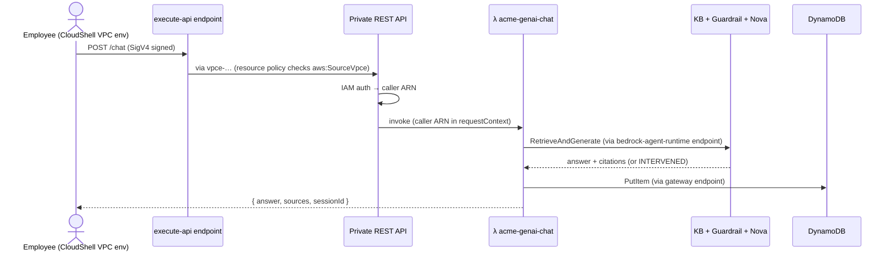

# Phase 5 — API + Lambda: The Assistant Goes Live (Privately)

> **Mission:** a Lambda inside the VPC answers questions through the Knowledge Base and Guardrail, behind a **private** API that only our VPC endpoint can reach, and every caller is identified. (Controls **G2**, **G3**, **G7**, **G8**)

[⬅ Phase 4](04-guardrail.md) · [Lab overview](../README.md) · [Phase 6 ➡](06-audit.md)

> [!NOTE]
> 📝 **Planned.** Steps are written ahead of the build and will be verified (with field notes) as it happens.

---

## Why this matters

This is where "private" becomes real. The API has **no public URL** that works from the internet, the Lambda has **no route out**, and its role **can't call Bedrock** except through our endpoint. API Gateway uses **IAM auth**, so we always know *who* asked.



## Concepts in 30 seconds

- **Private REST API:** endpoint type *Private*. Reachable only through an `execute-api` interface endpoint, and only if its **resource policy** allows it. (HTTP APIs can't be private; that's why we use REST.)
- **IAM authorization:** the caller signs the request with SigV4; API Gateway checks `execute-api:Invoke` and passes the caller's ARN to Lambda.
- **VPC Lambda:** Lambda creates ENIs in your subnets (needs `AWSLambdaVPCAccessExecutionRole`). Its own logs still reach CloudWatch, because the **Lambda service** ships them, not your code.
- **Sessions:** `RetrieveAndGenerate` returns a `sessionId`. Sending it back keeps the conversation context.

> [!NOTE]
> **Cost:** ≈ $0. Lambda, API Gateway and DynamoDB on-demand are within the free tier at lab volume.

---

## Steps

### 1 · DynamoDB table
`acme-genai-chat-history`: partition key `sessionId` (S), sort key `ts` (S), on-demand, default encryption.

### 2 · Lambda role
IAM → create role `acme-genai-chat-role` for Lambda:
- AWS managed: `AWSLambdaVPCAccessExecutionRole`
- Inline: [`policies/iam/lambda-chat-role.json`](../policies/iam/lambda-chat-role.json) (fill in the placeholders)

| Statement | Why |
|---|---|
| `KnowledgeBaseQuery` | `Retrieve` / `RetrieveAndGenerate` on **our** KB only |
| `InvokeApprovedModel` | KB calls Nova Micro **on our behalf**, so the role needs it |
| `ApplyGuardrail` | Required when the guardrail is attached to the call |
| `ChatHistory` | `PutItem` / `Query` on the one table |
| `DenyBedrockOutsideEndpoint` | **G3**: any Bedrock call not via our endpoints is denied, unless made by an AWS service on our behalf |

### 3 · Lambda function
`acme-genai-chat`, Python 3.12, arm64, 256 MB, timeout **30 s**, code from [`app/chat/handler.py`](../app/chat/handler.py).

- **VPC:** `acme-genai-vpc`, subnets `private-a` + `private-b`, SG `acme-genai-lambda-sg`
- **Environment:** `KB_ID`, `MODEL_ARN`, `GUARDRAIL_ID`, `GUARDRAIL_VERSION=1`, `TABLE_NAME`

Test it in the console with [`app/chat/test-event.json`](../app/chat/test-event.json).

### 4 · Private REST API
API Gateway → *REST API* → **Private** → `acme-genai-api`, associate the **execute-api VPC endpoint**.
1. Resource `/chat` → `POST` → **Lambda proxy** integration → `acme-genai-chat`.
2. Method request → **Authorization: AWS_IAM**.
3. **Resource policy:** [`policies/api/resource-policy.json`](../policies/api/resource-policy.json). It denies anything not coming through our `vpce-…`.
4. **Deploy** to stage `prod`. Resource-policy changes only take effect after a deploy.
5. Stage → *Throttling*: rate **2**/s, burst **5** (**G8**).

### 5 · Call it from inside the VPC
CloudShell → *Actions → Create VPC environment* → VPC `acme-genai-vpc`, subnet `private-a`, SG `acme-genai-lambda-sg`. Then:
```bash
eval "$(aws configure export-credentials --format env)"
curl -s https://<API_ID>.execute-api.us-east-1.amazonaws.com/prod/chat \
  --aws-sigv4 "aws:amz:us-east-1:execute-api" \
  --user "$AWS_ACCESS_KEY_ID:$AWS_SECRET_ACCESS_KEY" \
  -H "x-amz-security-token: $AWS_SESSION_TOKEN" \
  -H 'content-type: application/json' \
  -d '{"question":"How many days of parental leave do I get?"}'
```

## Verify

- From CloudShell **VPC env**: answer + sources ✅
- From your **laptop** (same URL): fails to resolve/connect ✅ (that's G2)
- DynamoDB has the turn, including the caller ARN

---

## ⚠️ Known gotchas

- **Reserved concurrency may be impossible on new accounts.** Accounts can start with a total Lambda concurrency of 10, and AWS keeps 10 unreserved, so `reserved concurrency = 2` fails. Use API throttling for G8 and request a higher concurrency quota if needed.
- **Cold starts in a VPC** are now fast (shared ENIs), but the first call after deploy can still take a few seconds. 30 s timeout covers it.
- **The API's default URL only works where private DNS for execute-api is on.** Elsewhere, use the endpoint-specific hostname `https://<API_ID>-<VPCE_ID>.execute-api.us-east-1.amazonaws.com/prod`.

## 🔥 Field notes

*Added during the build.*

---

## 🎤 Interview corner

<details><summary>How do you make an API Gateway API private?</summary>

Use a REST API with endpoint type *Private*, create an `execute-api` interface endpoint in the VPC, and attach a resource policy that allows `execute-api:Invoke` only when `aws:SourceVpce` (or `aws:SourceVpc`) matches. Without a resource policy, a private API rejects every call.
</details>

<details><summary>Your Lambda is in a VPC with no NAT. What can it reach?</summary>

Only what has a path inside the VPC: other VPC resources, interface endpoints, and gateway endpoints (S3, DynamoDB). Anything else times out. Its own CloudWatch logs still work because the Lambda service delivers them.
</details>

---

**Terraform:** planned stack `terraform/app/` (DynamoDB, role, Lambda, API, guardrail).

[⬅ Phase 4](04-guardrail.md) · [Lab overview](../README.md) · [Phase 6 ➡](06-audit.md)
