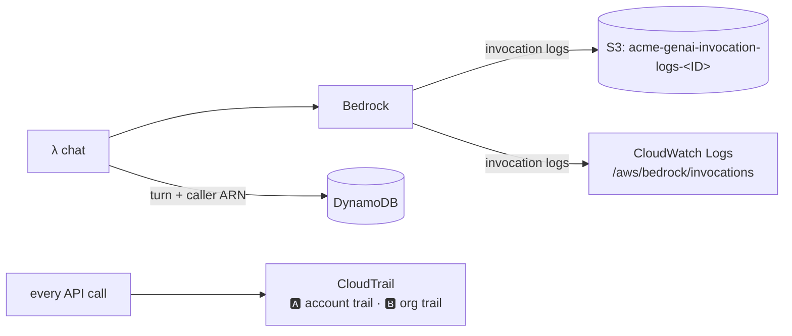

# Phase 6 — Audit: Who Asked What, and What Did It Say?

> **Mission:** keep a tamper-resistant record of every prompt, answer, model and caller, so security can investigate misuse and HR can prove what the assistant told people. (Control **G6**)

[⬅ Phase 5](05-api-lambda.md) · [Lab overview](../README.md) · [Phase 7 ➡](07-validation.md)

> [!NOTE]
> 📝 **Planned.** Steps are written ahead of the build and will be verified (with field notes) as it happens.

---

## Why this matters

"The AI said I get 6 months of leave" is a real HR dispute waiting to happen. You need the **exact** prompt and response, **which** model and guardrail version, and **who** asked. Three sources together give that:

| Source | Answers | Contains prompts? |
|---|---|---|
| **Bedrock model invocation logging** | What went into and came out of the model | ✅ full text |
| **CloudTrail** | Who called which Bedrock / API Gateway / Lambda API, from where | ❌ metadata only |
| **App log (DynamoDB + Lambda logs)** | Caller ARN, session, question, answer, guardrail action | ✅ |



> [!NOTE]
> **Cost:** S3 storage ≈ $0. CloudWatch Logs ingestion is $0.50/GB; lab volume is a few KB. Set a short retention anyway.

---

## Steps

### 1 · Log bucket
`acme-genai-invocation-logs-<ACCOUNT_ID>`: BPA on, SSE-S3, versioning on, lifecycle expire after **30 days**. Bucket policy: [`policies/logging/invocation-log-bucket.json`](../policies/logging/invocation-log-bucket.json) (Bedrock may write, only for **this** account, scoped with `aws:SourceAccount` + `aws:SourceArn`).

### 2 · Model invocation logging
Bedrock → *Settings* → **Model invocation logging** → on:
- data types: **Text** (Image/Embeddings off)
- destination: **Both** S3 (`acme-genai-invocation-logs-<ID>`) and CloudWatch Logs (`/aws/bedrock/invocations`, create a new role)

It's an account + region setting: it logs **every** model call in `us-east-1`, not just this app.

### 3 · CloudWatch retention
Set retention to **14 days** on `/aws/bedrock/invocations` and `/aws/lambda/acme-genai-chat`.

### 4 · CloudTrail
- **🅰️** Create a trail (single account, all regions) to an S3 bucket, log file validation **on**.
- **🅱️** Nothing to do: Lab 1's **org trail** already covers `genai-dev`. Optional stretch: also send invocation logs to the `security` account.

### 5 · A small dashboard
CloudWatch → Dashboards → `acme-genai`: Lambda invocations/errors/duration, API Gateway 4XX/5XX, Bedrock `Invocations` and `InputTokenCount`/`OutputTokenCount` for Nova Micro, and guardrail interventions (Logs Insights on the Lambda log: `guardrailAction = "INTERVENED"`).

## Verify

```bash
aws bedrock get-model-invocation-logging-configuration
aws logs tail /aws/bedrock/invocations --since 1h        # after one /chat call
aws dynamodb scan --table-name acme-genai-chat-history --max-items 3
aws cloudtrail lookup-events --lookup-attributes AttributeKey=EventSource,AttributeValue=bedrock.amazonaws.com --max-results 5
```

To check during the build:
- Do **Knowledge Base** model calls (`RetrieveAndGenerate`) show up in invocation logs?
- Which Bedrock runtime calls does CloudTrail record as **management** vs **data** events? Data events are off by default and cost extra.

---

## ⚠️ Known gotchas

- **Invocation logs contain everything users type**, including personal data. Treat the bucket like HR data: tight access, short retention, encryption.
- **Missing bucket policy = silent failure.** If Bedrock can't write, the console may still show logging as on. Check the log group/bucket after the first call.

## 🔥 Field notes

*Added during the build.*

---

## 🎤 Interview corner

<details><summary>What's the difference between CloudTrail and Bedrock invocation logs?</summary>

CloudTrail records **API activity**: who called `InvokeModel`, when, from which IP/endpoint, with which model ID. It doesn't store the prompt or response. Invocation logging stores the **content**: request and response bodies, token counts. You usually need both: CloudTrail to find the event, invocation logs to see what was said.
</details>

<details><summary>Logging prompts captures personal data. How do you handle that?</summary>

Minimise and protect it: short retention, encryption (KMS for stricter setups), access limited to a small security role, guardrail PII masking so answers don't echo it, and a documented purpose (audit/abuse detection). Some teams log only metadata plus a hash and keep full text for a few days.
</details>

---

**Terraform:** planned in `terraform/audit/`.

[⬅ Phase 5](05-api-lambda.md) · [Lab overview](../README.md) · [Phase 7 ➡](07-validation.md)
